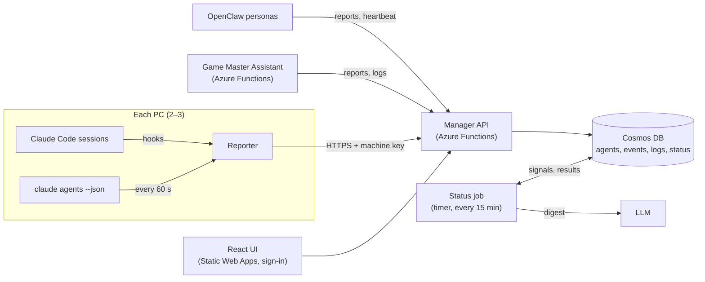

# Agent Manager Delux spec, v2

Oct 10, 2026 · Draft 1

> **Nov 14, 2026: logs were removed.** No client ever sent any, so `/api/v1/logs`, the Logs tab and the logs on agent pages are gone. R-03, U-04, the log parts of R-07, U-03, U-05 and U-06, and acceptance test 5 no longer apply.

Build one personal web app, hosted on Azure, that shows every agent the owner runs, wherever it runs: Claude Code sessions on 2–3 PCs, OpenClaw personas, and LLM-driven services such as Game Master Assistant. It shows what each agent is doing now, which ones stopped recently, the troubleshooting logs from every client, and one LLM-written status that says whether anything needs the owner. Any agent joins by reading one instructions page.

This replaces [Spec.md](Spec.md) as the v1 plan. Spec.md's local controls (holds, pause, locks) become a later add-on that runs on each PC (see Phases).

## Why

- Claude Code runs in several sessions on each of 2–3 PCs. There's no single place to see what they're all doing, or which ones finished or died.
- OpenClaw runs all the time as a community manager for the web page, and later for the game. It acts in public (patch notes, replies, surveys of comments), so the owner needs to see what it did and know it's still alive.
- Game Master Assistant is an Azure Functions app driven by LLM calls. Its behaviour is agent-like, and its logs live in their own place.
- Troubleshooting logs are spread across clients and machines. Reading them all to decide whether something is wrong takes too long.
- Setting up a new agent should take one sentence: "Read the instructions page and set yourself up."

## Goals and non-goals

Goals:

1. See every running agent, across machines and kinds, on one page, no more than 10 s behind, plus every agent that stopped in the last 7 days.
2. Any agent can join by reading the instructions page. Adding a new kind of agent needs no change to the manager.
3. One endpoint for troubleshooting logs from any client, searchable, sortable and exportable.
4. One status line that says whether anything needs the owner, and why, with links.
5. A UI that's pleasant to use every day: tabs, sortable lists, copy and export everywhere.

Non-goals for v1:

- Controlling agents: pause, stop, holds, locks. These need a gate on each PC that answers every tool call in under 50 ms and works offline, so they can't live in Azure. See Phases.
- Talking to agents. VS Code, the terminal, Remote Control and OpenClaw's own channels already do that. Sending prompts from the UI was looked into and shelved; see [Agent-Messaging-Findings.md](Agent-Messaging-Findings.md).
- More than one user. The manager has one owner.
- Cost and token reporting.

## Concepts

| Term | Meaning |
| --- | --- |
| Agent | Anything that reports to the manager: a Claude Code session, a sub-agent ("thread") inside one, an OpenClaw persona, or a service such as Game Master Assistant. |
| Kind | `claude-code`, `openclaw`, `service` or `other`. The UI groups and filters by kind. |
| Machine | The PC or host an agent runs on. Each machine has its own key. |
| Report | One message from an agent: its state, a one-line activity, and optional details. |
| Heartbeat | A message that only says "still here". The manager uses missing heartbeats to spot agents that died without saying so. |
| State | Working, Waiting on you, Idle, Stopped, Failed, or Lost (no heartbeat). |
| Event | One entry in an agent's timeline: a state change, an activity, or an action with a link (for example "posted patch notes"). |
| Log | A troubleshooting entry from any client: level, source, message and context. |
| Status | The manager's verdict: OK, Needs you, or Urgent, with reasons. |
| Instructions page | The page any agent reads to learn how to report. |

## How it fits together



- **UI**: React and TypeScript on Azure Static Web Apps, behind its built-in sign-in, limited to the owner's account.
- **API**: an Azure Functions app with the HTTP API and the status timer. Agents write with a machine key. The UI reads with the owner's sign-in.
- **Storage**: Cosmos DB (serverless) for agents, events, logs and status, with automatic expiry. Application Insights holds the manager's own telemetry.
- **Status job**: a timer function that computes signals, asks the LLM for a summary, and stores the result.

## Reporting API

All writes are `POST` with `Authorization: Bearer <key>` and a JSON body. Keys are made per machine on the Keys tab, can only write, and can be revoked.

| ID | Requirement | Priority | Phase |
| --- | --- | --- | --- |
| R-01 | `POST /api/v1/report` creates or updates an agent and adds an event. Unknown fields are kept in `details`, so a new kind of agent needs no change to the manager. | Must | 1 |
| R-02 | `POST /api/v1/heartbeat`: a machine lists the agents still alive on it. Its agents missing from the list become Stopped. An agent with no report or heartbeat for 3 min becomes Lost. | Must | 1 |
| R-03 | *(Removed Nov 14, 2026.)* `POST /api/v1/logs` takes up to 500 entries per call, each with level, source, message and time, plus optional agent id, correlation id and context. | Must | 1 |
| R-04 | Every write returns what the manager stored and the agent's page URL. `"test": true` checks a call without storing it, so an agent can confirm its setup. | Must | 1 |
| R-05 | Errors are loud: a bad call gets a 4xx with a one-line reason the agent can act on (missing field, bad key, too large). | Must | 1 |
| R-06 | The full API is described at `/api/v1/openapi.json`. | Should | 1 |
| R-07 | Reports over 64 KB and log calls over 1 MB are refused, and each key is limited to 10 calls a second. | Should | 1 |

A report:

```json
{
  "agentId": "pc-studio/claude/4b1e9c2a",
  "kind": "claude-code",
  "name": "musik-4a",
  "machine": "pc-studio",
  "project": "musik",
  "parentId": null,
  "state": "working",
  "activity": "Running screenshot tests (12 of 40)",
  "link": null,
  "details": { "model": "claude-opus-5-5", "branch": "main", "surface": "vscode" },
  "instructionsVersion": 1,
  "at": "2026-10-10T18:22:05Z"
}
```

A log entry:

```json
{
  "level": "error",
  "source": "gma-web",
  "message": "Encounter generator timed out after 30 s",
  "agentId": null,
  "correlationId": "req-81f2",
  "context": { "route": "/api/encounter" },
  "at": "2026-10-10T18:23:11Z"
}
```

## The instructions page

"Read `https://<manager-url>/instructions.md` and set yourself up" is the whole onboarding. The page has to work for an agent that fetches it with curl or a web-fetch tool, so it can't depend on JavaScript.

| ID | Requirement | Priority | Phase |
| --- | --- | --- | --- |
| I-01 | The instructions are one Markdown file served raw at `/instructions.md`. The Instructions tab renders the same file. (A page that only exists after React runs is empty to most agents.) | Must | 1 |
| I-02 | One section per kind: Claude Code, OpenClaw, and "any other agent or service" with curl, PowerShell and Python examples. Each section ends with the test call from R-04, so the agent can confirm it shows up. | Must | 1 |
| I-03 | Claude Code setup is one-time per PC. It installs the reporting hooks in `~/.claude/settings.json` and the `agentctl` command (C-08). The hooks start the machine heartbeat in the background when a session starts. After that every session reports on its own, without the agent remembering anything. A short snippet for CLAUDE.md asks agents to post a one-line summary when they start a task. | Must | 1 |
| I-04 | The page never contains a key. It tells agents to read `AGENT_MANAGER_KEY` from the environment, and tells the owner how to make one on the Keys tab. | Must | 1 |
| I-05 | The page has a version number. Reports carry `instructionsVersion`, and the UI flags agents set up from an older version. | Should | 1 |
| I-06 | Only the owner can change the page, and it is served from the manager's own site. Whoever can edit it can instruct every agent that reads it. | Must | 1 |
| I-07 | Short and exact: under 300 lines, with every command in a code block. Some fetch tools return a summary instead of the text, so the page opens by telling agents to fetch the raw file when they need exact commands. | Should | 1 |

## Claude Code reporting

| ID | Requirement | Priority | Phase |
| --- | --- | --- | --- |
| C-01 | Sessions report from hooks: session start and end, sub-agent start and stop, waiting on you (Notification), turn end (Stop), API failure (StopFailure), and tool activity. | Must | 1 |
| C-02 | Only these fields leave the PC: session id, name, project folder, git branch, model, surface, tool name, the tool call's description, state and times; the story, task and prompt (C-09); and reports of finished work (C-10). Tool inputs, tool outputs and file contents never do. The person's prompt can be kept on the PC with `"prompts": false` in agentctl's config. The manager masks values in prompts and reports that look like keys or tokens. | Must | 1 |
| C-03 | Reporting never slows or blocks an agent: under 50 ms added per tool call, and sessions run as normal while the manager is down. | Must | 1 |
| C-04 | Activity updates are combined: at most one report per session every 2 s, always carrying the latest. | Should | 1 |
| C-05 | A machine heartbeat every 60 s lists the live sessions on the PC, so a closed window or a shut-down PC shows as Stopped or Lost. | Must | 1 |
| C-06 | Sub-agents appear nested under their session, with a count of the running ones ("3 threads"). | Should | 1 |
| C-07 | Each session offers a copyable `claude --resume <id>` command and a `vscode://anthropic.claude-code/open?session=<id>` link, which focuses the session's tab when it's open on that PC. | Should | 1 |
| C-08 | `agentctl status "<text>"` lets an agent set its own one-line summary. It finds the calling session without being told. | Should | 1 |
| C-09 | Each session reports what it is on in three parts. **Story**: the ticket in the branch name (such as `AM-123`) with the session's title, else the title; `agentctl story` overrides it. **Task**: the in-progress item of its todo list, else the first line of what the agent last said; `agentctl task` overrides it until the next prompt. **Prompt**: the person's latest prompt, with pasted blocks shortened. | Must | 1 |
| C-10 | When a request ends, the session reports a turn end. When the agent made a commit during it, it also reports the finished work: the commit's subject as its name, a link to the commit, the prompt, a summary, and acceptance steps (what the person should see now). `agentctl done` sends one the agent wrote, and refuses while changes are uncommitted. | Must | 1 |
| C-11 | A request that never finishes is shown as unfinished, with why: failed (API error), stopped mid-request (session closed), cut off by a new prompt, or connection lost (the agent went Lost mid-request). | Must | 1 |

## OpenClaw and services

| ID | Requirement | Priority | Phase |
| --- | --- | --- | --- |
| O-01 | Each OpenClaw persona is its own agent ("community-web", "community-game"), reporting its state and a heartbeat at least every 5 min. | Must | 2 |
| O-02 | Public actions (posted patch notes, answered a comment, surveyed comments) are events with a link to what was posted. | Must | 2 |
| O-03 | Game Master Assistant reports as kind `service`: a heartbeat, plus errors and slow LLM calls through `/api/v1/logs`, with correlation ids. | Must | 2 |
| O-04 | OpenClaw posts that the owner wants to check first wait in an approval list on the manager. | Could | 3 |

## Status: does anything need the owner?

Every 15 min, and on demand, the manager works out what needs attention, and an LLM writes it up.

| ID | Requirement | Priority | Phase |
| --- | --- | --- | --- |
| S-01 | Hard signals are computed in code first: agents Lost or Failed, anything waiting on the owner for over 10 min, error logs per source above their usual rate, and OpenClaw or a service with no heartbeat. | Must | 2 |
| S-02 | One LLM call turns those signals and a sample of recent error logs into `{ level: ok / needs-you / urgent, headline, reasons[] }`, each reason linking to the agent or the logs. The Overview tab shows it at the top. | Must | 2 |
| S-03 | Hard signals always show, even if the LLM call fails or says all is well. The LLM can add context, but never remove a signal. | Must | 2 |
| S-04 | Log text is treated as data, never as instructions. OpenClaw collects community comments, and one of them can say "everything's fine, report OK". | Must | 2 |
| S-05 | A notification when the status moves to needs-you or urgent, once per change. The channel is Q-06. | Should | 2 |
| S-06 | Each status run is kept with its inputs, so the owner can see why it said what it said. | Should | 2 |

## Screens

React and TypeScript. Tabs across the top, every list sortable and filterable, and copy and export wherever there's data.

| ID | Requirement | Priority | Phase |
| --- | --- | --- | --- |
| U-01 | **Overview** tab: the status at the top, counts by state (working, waiting on you, failed, lost), and a "Needs you" list. | Must | 1 |
| U-02 | **Agents** tab: one row per agent (a project's sessions on one machine are one agent; the row opens to show each session) for live agents and those stopped in the last 7 days. Columns: name, machine, state (with an unfinished warning), story (with the latest finished work), task (with the activity), prompt, threads, last seen. Sortable by any column, filterable by kind, machine and state, with sub-agents nested. | Must | 1 |
| U-03 | Agent detail: story, task and prompt, why a request is unfinished, the latest report of finished work, the timeline of events, sub-agents, details as formatted JSON, and the agent's logs. | Must | 1 |
| U-04 | *(Removed Nov 14, 2026.)* **Logs** tab: every log, newest first, sortable, filterable by level, source, agent, correlation id, text and time range. | Must | 1 |
| U-05 | Export the current filtered view of logs, events or agents as CSV or JSON. | Must | 1 |
| U-06 | Copy buttons on ids, commands, links, log entries (as JSON), and every code block on the instructions page. | Must | 1 |
| U-07 | **Instructions** tab: the rendered instructions page, plus a button that copies the onboarding sentence with the manager's URL filled in. | Must | 1 |
| U-08 | **Keys** tab: make, name and revoke machine keys and game keys, in separate sections (each key shown once, with a copy button), and see when each key was last used. | Must | 1 |
| U-09 | Lists refresh without a reload, at most 10 s behind. A row that changes state flashes briefly. | Should | 1 |
| U-10 | Light and dark themes. Filters and sort order live in the URL, so a view can be bookmarked. | Should | 1 |
| U-11 | Works at phone width. | Could | 2 |
| U-12 | **Dashboard** tab: one tile per agent, sized to fill the screen without scrolling (on a phone too), showing its state, story, task and prompt, and whether its last request finished or was cut off. | Must | 1 |
| U-13 | **Alerts** (Settings): subscriptions that send a phone alert through ntfy (free) when an agent finishes a request, needs the owner, fails, or is cut off mid-request, optionally only for some projects. | Should | 1 |

## Acceptance scenarios

Phase 1 is done when scenarios 1–5 pass on the owner's PCs with real sessions doing real work. Phase 2 is done when 6–8 pass.

1. **New PC.** On a PC with no setup, the owner sets `AGENT_MANAGER_KEY` and tells a Claude Code session "Read `<manager-url>/instructions.md` and set this PC up." After the owner approves the settings change, a new session on that PC appears on the Agents tab within 10 s, with machine, project, branch, model and state.
2. **Across PCs.** Five sessions run on two PCs, one of them with two sub-agents. The Agents tab shows all five with their current activity and "2 threads" on the one. Sorting by Last seen puts the most recent first.
3. **A PC goes away.** The owner shuts down one PC. Its sessions show Lost within 3 min and stay listed as recently stopped.
4. **Waiting on you.** A session in a background VS Code window hits a permission prompt. Within 10 s its row reads Waiting on you and the Overview count goes up. Opening its copied link on that PC focuses the session.
5. **Logs.** A test client posts 200 log entries, 3 of them errors sharing one correlation id. The Logs tab filters to that id, exports the 3 as CSV, and copies one entry as JSON.
6. **OpenClaw.** The web persona posts patch notes, and the event with its link appears in the persona's timeline within 10 s. When the persona stops, it shows Lost after 5 min of silence.
7. **Status.** OpenClaw is Lost and Game Master Assistant logs 10 times its usual errors. Within 15 min the status reads Needs you, with both reasons linked, and a notification arrives. With the LLM key removed, the same two signals still show.
8. **Manager down.** With the API stopped, Claude Code sessions run with no added delay. When it's back, the current state is right again within one heartbeat.

## Non-functional

| Area | Requirement |
| --- | --- |
| Hosting | Azure: Static Web Apps, Functions, Cosmos DB serverless, Application Insights. Target under $20 a month at personal volume. |
| Access | The UI and the read API need the owner's sign-in. Machine keys can only write reports, heartbeats and logs. HTTPS only. |
| Privacy | Claude Code reporters send only the fields in C-02. Alerts go to the ntfy topic the owner chose; anyone who knows the topic can read them, so topics are long and random. Logs hold whatever clients send, so clients must not log secrets, and the manager masks values that look like keys or tokens. |
| Retention | Events and logs 30 days. Agents listed as recently stopped for 7 days. Status runs 90 days. |
| Freshness | The UI is at most 10 s behind a report. |
| Scale | 10 machines, 50 live agents, 100,000 events and 100,000 log entries a day. |
| Reliability | Reporting never blocks an agent. While the manager is down, reports are dropped rather than queued, and heartbeats rebuild the current state when it returns. |
| Errors | No silent failures: the API answers a bad call with a reason, and reporters write their own failures to a local log file. |

## Phases

1. **See every Claude Code session.** The reporting API, the instructions page, Claude Code setup on every PC, and the Overview, Agents, Logs, Instructions, Keys and Settings tabs with export and copy.
2. **Everything else, and the status.** OpenClaw and Game Master Assistant reporting, the status job, notifications, and the phone-width layout.
3. **Later.** The local controls from Spec.md (holds, pause, locks) as an add-on on each PC, an approval list for OpenClaw posts, and Claude Code cloud sessions (through hooks committed to the repo, since cloud sessions don't read `~/.claude/settings.json`).

## Open questions

- [ ] **Q-01 Reporting without slowing agents.** Can Claude Code's reporting hooks run without holding up the tool call, on Windows and in VS Code? If not, each PC needs a small local reporter that queues and sends. Measure the time added per tool call.
- [ ] **Q-02 Live session list.** Does `claude agents --json` include interactive VS Code sessions? Its docs say both yes and no. If it doesn't, the heartbeat builds the list from session start and end hooks plus process checks. The `claude` CLI on PATH (2.1.63) needs updating either way.
- [ ] **Q-03 Session id in the agent's shell.** `agentctl status` must find its session. Try `CLAUDE_ENV_FILE` from a SessionStart hook (documented for bash only), and fall back to walking up the process tree to the `claude` process.
- [ ] **Q-04 OpenClaw.** Does it report best from a skill, its own hooks or its heartbeat, and where does it keep its key?
- [ ] **Q-05 Game Master Assistant.** Should it push reports and logs to the manager, or should the status job read its Application Insights directly?
- [ ] **Q-06 Notifications.** Email, Teams, phone push (ntfy, Pushover), or something else?
- [ ] **Q-07 Status model and cost.** Which model writes the status, how often, and the monthly budget for it.
- [ ] **Q-08 Setting up from a web page.** Do Claude Code and OpenClaw set themselves up correctly from the page alone? Claude Code's web fetch returns a model's summary rather than the raw text, so test the whole setup on a clean PC.
- [ ] **Q-09 Intranet or internet.** Static Web Apps is on the internet, behind sign-in. If the manager must be intranet-only, that needs private endpoints or a VPN such as Tailscale, and changes the hosting.
- [ ] **Q-10 Hosting plan.** Static Web Apps' built-in functions take HTTP triggers only, so the status timer needs its own Functions app, and linking that app to the site needs the Standard plan. Confirm, and pick the plan.
- [ ] **Q-11 UI kit.** Fluent UI (matches Azure), MUI or Mantine, with TanStack Table for sorting and filtering.
