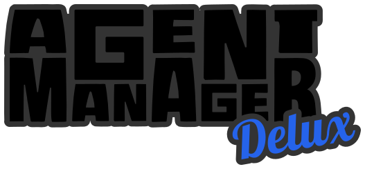
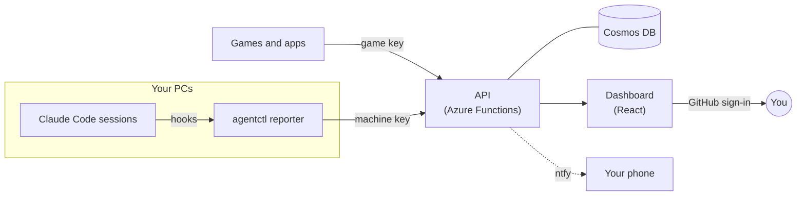

<p align="center">
  
</p>

<p align="center">
  <b>A self-hosted dashboard for the AI agents you run.</b><br>
  See which Claude Code sessions on your PCs are working, which are waiting on you,<br>
  and what each one finished and wants you to check.
</p>

<p align="center">
  <a href="LICENSE"></a>
  
  
  
  
</p>

<p align="center">
  <a href="#get-started-in-3-steps">Get started</a> ·
  <a href="#what-you-get">Features</a> ·
  <a href="#how-it-works">How it works</a> ·
  <a href="#setting-up-an-agent-send-it-a-link">Set up an agent</a> ·
  <a href="#how-keys-work">Keys</a> ·
  <a href="#deploy-to-azure">Deploy</a> ·
  <a href="#connect-a-pc">Connect a PC</a>
</p>

## Get started in 3 steps

### 1. Deploy your own copy

Make an empty folder, open Claude Code in it, and paste this:

```text
Read https://raw.githubusercontent.com/esiege/agent-manager-delux/main/deploy.md and deploy my own Agent Manager Delux from this folder.
```

Claude Code checks your tools, gets the code and builds it. Then it walks you through signing in to Azure and puts the site on the Free plan, where only your GitHub account can sign in. It stops and asks whenever it needs you. You need an [Azure account](https://azure.microsoft.com/free) (the free one is enough) and about 10 minutes.

<details>
<summary><b>Other ways to set it up</b></summary>
<br>

| If you... | Do this |
| --- | --- |
| Already cloned this repo | Open Claude Code in the clone and say: *Read deploy.md in this repo and deploy my own Agent Manager Delux.* |
| Use a different agent | Send it the same sentence. Any agent that can run shell commands can follow [deploy.md](deploy.md). |
| Would rather do it yourself | Follow [Deploy to Azure](#deploy-to-azure): two commands. |
| Want to try it on your PC first | See *Run it locally* under [For contributors](#for-contributors). No Azure needed. |
| Already deployed, and want the latest | Run `git pull`, then `./scripts/deploy.ps1 -SkipInfra`. |

</details>

### 2. Copy this sentence

Once your site is live, copy this sentence. The site's **Instructions** tab has it with your address filled in.

> Read `https://<your-site>/instructions.md` and set yourself up to report to Agent Manager Delux.

### 3. Send it to your agent

Send it to Claude Code on each PC you run agents on. That's it: the agent sets itself up and shows up on the **Agents** tab. The first time on a PC, it tells you how to make the PC's key on the **Keys** tab.

## Why

If you run agents in several windows on more than one machine, you lose track of them. You find out a session was waiting for approval an hour after it asked, or you can't remember which one fixed what. Agent Manager Delux gives you one page that's never more than a few seconds behind.

## What you get

- **Live status.** Every session on every PC: working, waiting on you, idle, or stopped. Closed windows are noticed within a minute.
- **What each one is doing.** The story it's working on, its current step, and your latest prompt to it.
- **Finished work, with what to check.** When an agent finishes, it reports what it did in a few bullets, a list of things for you to check, and a link to the commit.
- **Reporting.** Work sorted by type (features, bug fixes, docs and so on), with what the tokens would have cost at API list prices.
- **Phone alerts** through [ntfy](https://ntfy.sh) when an agent finishes, waits on you, fails, or is cut off mid-request. You can limit them to certain projects.
- **Messages to an idle session** from its page. Off by default, and turned on separately on each PC.
- **Other agents and services** can report through the same API. Any agent sets itself up by reading the instructions page the site serves.
- **Performance data from games and apps:** frame times and memory per machine, sent with a separate key that can do nothing else. See [below](#performance-data-from-games-and-apps).

## How it works



Agent Manager Delux is two parts:

1. **The site:** a React UI and a small API on Azure Static Web Apps, with Cosmos DB (serverless) for storage. One script deploys it to your own Azure account, and on the Free plan it costs close to nothing. Only the GitHub logins you list can sign in.
2. **The reporter** (`agentctl`): one Node file on each PC, with no dependencies. Claude Code runs it from hooks in your user-level settings, so every session on that PC reports without you doing anything per session or per project. Each PC has its own key, which you can revoke on its own.

## Setting up an agent: send it a link

There's no SDK to install and no setup guide for you to follow. The site serves plain Markdown pages written for agents, and you set an agent up by sending it one sentence with a link:

> Read `<your site>/instructions.md` and set yourself up to report to Agent Manager Delux. If this PC has no machine key yet, explain how to set one up.

The agent fetches the page and follows it. The **Instructions** tab has each sentence ready to copy, with your site's address filled in.

| Page | Send it to | What the agent does |
| --- | --- | --- |
| [`/instructions.md`](web/public/instructions.md) | An agent on a PC that isn't set up yet | Installs the reporter for Claude Code, or learns the API calls if it's another kind of agent or a service. |
| [`/update.md`](web/public/update.md) | An agent on a PC that's already set up | Checks whether the PC is on the latest version, and updates it if not. |
| [`/performance.md`](web/public/performance.md) | The agent building a game or app | Adds performance reporting to the game. |

The links above open the files in this repo, so you can read exactly what an agent will be told before you deploy anything. Your site serves the same files.

Three things make this safe to hand to an agent:

- **The pages are public, and hold no secrets.** Anyone can read them, but they can't do anything without a key. The key is never on a page: you make it on the Keys tab, and the agent reads it from `AGENT_MANAGER_KEY` (or, for a game, from wherever you put it).
- **The pages include a check to run,** so the agent can prove the setup works before telling you it's done.
- **The setup and update pages say when to stop and ask you.** For example, Claude Code in auto mode won't let an agent change Claude Code's own settings, so the page tells the agent which commands to hand you instead.

## What leaves your PC

The reporter sends:
- **Session events:** start and end, waiting on you, sub-agents, API failures, and token counts.
- **Tool activity:** the tool's name and its short description only. It never sends commands, their output, or file contents.
- **Your prompts,** up to 2,000 characters. Pasted text is replaced with `[pasted text]`, and the server masks anything that looks like a secret. To keep prompts on the PC, set `"prompts": false` in `~/.agent-manager/config.json`.
- **Git details:** the project's name, the branch, and a link to the commit, built from the repo's remote.

> [!NOTE]
> Everything goes to your own deployment and nowhere else.

## Performance data from games and apps

If your agents are building a game or an interactive app, the **Performance** tab shows how it runs on each machine. Each run of the game is a session, and during the run the game sends a sample every few seconds:

- **Frame times:** FPS, the 50th, 95th and 99th percentile frame times, the slowest frame, and hitch counts. The 99th percentile shows stutter that an average hides.
- **Where the time goes:** game-thread, render-thread and GPU time, so you can see which one each frame waited on.
- **Memory and more:** memory, video memory, draw calls, ping, and up to 32 numbers of your own, each with its own chart.
- **Context:** the build, CPU, GPU, resolution and quality settings. You can compare runs across machines, builds and GPUs, and break one run down by level or scene.
- **Single slow frames,** so you have something to open in a profiler. Each session keeps its worst 50.

It's plain HTTPS and JSON, so it works from any engine. The game uses a **game key**, which can only send performance data. That makes it safe to ship in a build that runs on other people's machines. To set it up, point the agent working on the game at `<your site>/performance.md` ([read it here](web/public/performance.md)). That page covers what to send and how to do it without costing frames. Agents on a set-up PC can read the results back with `agentctl perf`.

Sessions and their totals are kept for a year. The detailed samples behind the charts are kept for 30 days.

## How keys work

There are two ways in. You sign in with GitHub and can see and change everything. Anything that isn't you (the reporter on a PC, a game, another service) uses a key that you make on the **Keys** tab.

A key looks like `am_<id>_<secret>` and goes in the `X-Agent-Manager-Key` header of every call.

> [!TIP]
> Not `Authorization`: Static Web Apps replaces that header before it reaches the API.

| Kind | Who uses it | What it can do |
| --- | --- | --- |
| **Machine key** | The reporter on one PC, or any agent or service you trust | Report agents and their work, fetch messages for its sessions, and read performance data. It can't read the dashboard, or make or revoke keys. |
| **Game key** | A game or app build | Send performance data, and nothing else. It can't read anything back, so it's safe in a build that runs on other people's machines. Any other call answers 403. |

What the server does with a key:

- **It's shown once.** The server stores only a SHA-256 hash of the key, so nobody can read it back later, including you. If you lose one, make another.
- **Each call is checked against the hash,** then against the key's kind. A missing, unknown or revoked key answers 401 with a line saying which.
- **Revoking** is a button on the Keys tab. It can take up to a minute to reach every server instance, because checked keys are cached for 60 seconds.
- **Each key is limited** to 10 calls a second, with bursts up to 20. More than that answers 429.
- **The Keys tab shows when each key was last used** (to within 5 minutes), so you can spot one that's idle or busier than it should be.

Make one key per PC and one per game, named after it. Then you can revoke one without touching the others, and each performance session shows which key sent it.

The design is in [Docs/Spec-v2.md](Docs/Spec-v2.md).

## Deploy to Azure

To have an agent do this for you, see [Get started](#get-started-in-3-steps). To do it yourself:

```powershell
az login
./scripts/deploy.ps1 -OwnerLogins <your-github-username>
```

It creates the resource group `agent-manager` with a Static Web App (Free plan), a serverless Cosmos DB account and Application Insights, then builds and uploads the app. Sign-in is through GitHub, and only the GitHub usernames in `-OwnerLogins` can see anything; everyone else gets "isn't the owner account". Run it again to ship changes (`-SkipInfra` skips the Bicep step).

## Connect a PC

> [!IMPORTANT]
> Once per PC, and you run it yourself: Claude Code in auto mode won't let an agent change Claude Code's own settings.

The full steps are in [Docs/Claude-Code-Setup.md](Docs/Claude-Code-Setup.md). In short:

1. In Agent Manager Delux, open **Keys** and make a machine key named after the PC. Run the PowerShell line it shows, which saves the key as `AGENT_MANAGER_KEY`.
2. In your own PowerShell window on that PC, download `agentctl` from `<your site>/agentctl.js` into `~/.agent-manager`, then run `node "$HOME\.agent-manager\agentctl.js" install --url <your site>`, then `doctor`.

`install` adds hooks to `~/.claude/settings.json` (backed up first). From then on every session reports in the background:

- **What it reports:** session start and end, prompts, tool activity, waiting on you, sub-agents, and API failures. For the details, see [What leaves your PC](#what-leaves-your-pc).
- **Closed windows:** a heartbeat process, started by the hooks, checks every 60 s which Claude Code processes are still alive.

Run `node "$HOME/.agent-manager/agentctl.js" doctor` to check a PC.

## For contributors

<details>
<summary><b>Layout</b></summary>

| Folder | What it is |
| --- | --- |
| `shared/` | The data contract (types, validation, state rules, secret masking) used by everything else. |
| `api/` | Azure Functions (Node, v4 model), bundled into one file. Ingest for agents (machine keys) and reads for the UI (owner sign-in). |
| `web/` | React + Mantine UI. `public/instructions.md` is the page agents read; `public/staticwebapp.config.json` sets routes and sign-in. |
| `reporter/` | `agentctl`, the Claude Code reporter: one Node file that the hooks run. Built into `web/public/agentctl.js` so agents can download it. |
| `infra/` | `main.bicep`: Static Web App, Cosmos DB serverless, Application Insights. |
| `scripts/` | `deploy.ps1`: creates or updates the Azure resources, builds, and uploads. |

</details>

<details>
<summary><b>Run it locally</b></summary>

```powershell
npm install
Copy-Item api/local.settings.example.json api/local.settings.json   # then set DEV_OWNER to any name
npm run build -w reporter            # puts agentctl.js in web/public
npm run dev:api                      # http://localhost:7071 (needs Azure Functions Core Tools 4)
npm run dev:web                      # http://localhost:5173, proxies /api to the Functions host
```

Locally, data is kept in `api/.local-store.json` and `DEV_OWNER` stands in for a signed-in owner (ignored in Azure). Tests: `npm test`. Types: `npm run typecheck`.

</details>
